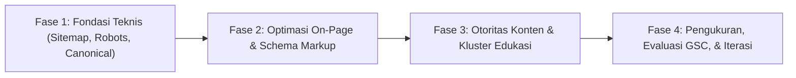

# Strategi SEO Teknis & Pertumbuhan Pencarian Organik BumiLoka

Dokumen ini adalah **pedoman resmi rekayasa SEO (*Search Engine Optimization*) teknis, arsitektur konten semantik, data terstruktur, dan strategi penelusuran organik** untuk platform **BumiLoka**.

Tujuan dokumen ini adalah membangun visibilitas pencarian organik yang berkelanjutan, relevan, berwibawa, dan dapat diukur secara jangka panjang pada pencarian web berbahasa Indonesia seputar agriteknologi dan budidaya hidroponik.

> **Prinsip Utama:** Proyek ini **DILARANG** menjanjikan atau menargetkan peringkat instan nomor satu di Google (*guaranteed #1 ranking*). Seluruh optimasi dirancang untuk kepatuhan algoritma mesin pencari modern (Google Helpful Content & E-E-A-T), kepuasan pengguna nyata, keterpahaman bot perayap (*crawlability & indexability*), dan keunggulan teknis Core Web Vitals.

---

## 1. Konvensi Kepatuhan (RFC 2119)

- **`MUST` / `WAJIB`**: Standar teknis yang harus dipenuhi dalam setiap rilis dan pembaruan kode.
- **`MUST NOT` / `DILARANG`**: Praktik manipulatif atau terlarang yang merusak reputasi domain.
- **`SHOULD` / `DIANJURKAN`**: Rekomendasi optimasi terbaik untuk visibilitas dan konversi.
- **`MAY` / `DIPERBOLEHKAN`**: Pilihan eksperimen yang diuji secara terkendali.

---

## 2. Riset Kata Kunci & Pemetaan Niat Penelusuran (*Search Intent*)

### 2.1. Gugus Tema Kata Kunci Kandidat (*Candidate Keyword Themes*)
BumiLoka menargetkan segmen penelusuran hidroponik di Indonesia. Gugus tema kata kunci potensial meliputi:
- **Tema Budidaya Dasar:** *hidroponik*, *pertanian hidroponik*, *cara menanam hidroponik*, *budidaya hidroponik*, *tanaman hidroponik*, *panduan pertanian untuk pemula*.
- **Tema Teknis Nutrisi & Air:** *nutrisi tanaman hidroponik*, *takaran ab mix hidroponik*, *pH dan EC hidroponik*, *suhu air tandon hidroponik*.
- **Tema Gangguan & Gejala Daun:** *penyakit tanaman hidroponik*, *penyebab tip burn selada*, *daun hidroponik menguning*, *akar hidroponik cokelat*.
- **Tema Panen & Pemasaran:** *hasil panen hidroponik*, *marketplace hasil panen*, *jual sayuran hidroponik segar*, *pra-pesan panen hidroponik*.

> *Peringatan Kredibilitas Data:* Kata kunci di atas merupakan **hipotesis tema kandidat** berdasarkan relevansi produk. Agen dan pemasar **DILARANG** mengarang angka volume pencarian (*search volume*), tingkat kesulitan kata kunci (*keyword difficulty*), atau proyeksi klik tanpa validasi data dari Google Search Console atau alat riset terakreditasi (Ahrefs, Semrush, Google Keyword Planner).

### 2.2. Klasifikasi Niat Penelusuran (*Search Intent Hierarchy*)
Setiap halaman yang dibuat wajib memetakan tepat **satu niat penelusuran primer**:
1. **Informational Intent (Edukasi & Rujukan):**
   - *Kueri contoh:* "penyebab tip burn pada selada hidroponik", "berapa ppm ideal pakcoy hidroponik".
   - *Target halaman:* Artikel panduan, studi kasus agronomi, dokumentasi asisten AI.
2. **Commercial Investigation Intent (Evaluasi Layanan):**
   - *Kueri contoh:* "aplikasi pencatatan kebun hidroponik", "platform jual beli hasil panen hidroponik".
   - *Target halaman:* Halaman Beranda (`/`), perbandingan fitur, tinjauan kapabilitas modul.
3. **Transactional Intent (Tindakan Nyata):**
   - *Kueri contoh:* "langganan platform bumiloka", "pesan sayuran hidroponik segar bandung".
   - *Target halaman:* Bagian penawaran langganan (`#langganan`), katalog batch panen.
4. **Navigational Intent (Pencarian Merek):**
   - *Kueri contoh:* "bumiloka", "bumiloka hidroponik", "bumiloka agritech".
   - *Target halaman:* Halaman utama resmi (`https://bumiloka.id`).

### 2.3. Pencegahan Kanibalisasi Kata Kunci (*Anti-Cannibalization*)
- Dua halaman berbeda dalam satu situs **DILARANG** mengincar kata kunci primer yang identik dengan maksud pencarian yang sama.
- Jika terdapat topik yang saling beririsan, gunakan strategi *Pillar-Cluster*: Halaman utama membahas topik secara holistik dan menautkan tautan internal ke artikel panduan mendalam.

---

## 3. Arsitektur Informasi & Strategi Konten

### 3.1. Rencana Struktur Halaman BumiLoka
Arsitektur halaman BumiLoka dirancang proporsional untuk platform AgriTech tahap awal:

| Tipe Halaman | Niat Pencarian | Tema Kata Kunci Primer | Peran & Masalah Pengguna | Status Implementasi |
| :--- | :--- | :--- | :--- | :---: |
| **Homepage (`/`)** | Commercial & Navigational | *platform budidaya hidroponik*, *bumiloka* | Memperkenalkan ekosistem 3 pilar (Pengelolaan, Marketplace, Asisten AI). | **Aktif (Live)** |
| **Panduan Edukasi** | Informational | *cara menanam hidroponik pemula*, *manajemen tandon* | Panduan langkah demi langkah bagi petani skala rumahan. | Direncanakan (Fase 3) |
| **Pustaka Gejala AI** | Informational | *penyakit tanaman hidroponik*, *gejala tip burn* | Rujukan pemeriksaan awal saat daun menguning atau terbakar. | Direncanakan (Fase 3) |
| **Katalog Panen** | Transactional | *hasil panen hidroponik segar*, *pra-pesan selada* | Mempertemukan batch sayuran siap panen dengan pembeli lokal. | Pratinjau Konsep |
| **Tentang & Kebijakan** | Trust / E-E-A-T | *tentang bumiloka*, *kebijakan privasi* | Menjelaskan identitas pengembang dan transparansi operasional. | Direncanakan (Fase 2) |

> **Larangan Spam Doorway Pages (`MUST NOT`):** Agen **DILARANG KERAS** membuat puluhan halaman arahan tipis (*thin landing pages*) yang hanya memodifikasi nama kota/varietas (misal: "hidroponik di kota A", "hidroponik di kota B") tanpa menyajikan konten atau layanan nyata yang berbeda.

---

## 4. Spesifikasi SEO Teknis (Next.js 15 App Router)

### 4.1. Metadata API Next.js (`src/app/layout.tsx` / `page.tsx`)
Seluruh halaman terindeks wajib mengonfigurasi objek `Metadata` bawaan Next.js secara dinamis dan presisi:

```typescript
import type { Metadata } from "next";

export const metadata: Metadata = {
  metadataBase: new URL(process.env.NEXT_PUBLIC_SITE_URL || "https://bumiloka.id"),
  title: {
    default: "BumiLoka — Platform Budidaya Hidroponik (Pengelolaan Kebun, Marketplace Panen, Asisten AI)",
    template: "%s | BumiLoka",
  },
  description:
    "BumiLoka membantu petani hidroponik memantau kondisi air tandon harian, memahami kendala daun lewat asisten AI, serta mempertemukan hasil panen segar dengan calon pembeli sebelum hari potong.",
  alternates: {
    canonical: "/",
  },
  openGraph: {
    title: "BumiLoka — Platform Budidaya Hidroponik Terpadu",
    description:
      "Bantu petani hidroponik merawat instalasi secara disiplin dan memasarkan hasil panen sebelum hari potong.",
    url: "https://bumiloka.id",
    siteName: "BumiLoka",
    locale: "id_ID",
    type: "website",
    images: [
      {
        url: "/images/hero-greenhouse-fullbleed.jpg",
        width: 1200,
        height: 630,
        alt: "Instalasi kebun hidroponik greenhouse komersial BumiLoka",
      },
    ],
  },
  twitter: {
    card: "summary_large_image",
    title: "BumiLoka — Platform Budidaya Hidroponik Terpadu",
    description:
      "Pantau nutrisi tandon, atasi gejala tanaman dengan AI, dan buka pra-pesan panen sayuran segar.",
    images: ["/images/hero-greenhouse-fullbleed.jpg"],
  },
  robots: {
    index: true,
    follow: true,
    googleBot: {
      index: true,
      follow: true,
      "max-video-preview": -1,
      "max-image-preview": "large",
      "max-snippet": -1,
    },
  },
};
```

### 4.2. Peta Situs Dinamis (*Dynamic Sitemap*) & Protokol Robot
1. **Sitemap XML (`src/app/sitemap.ts`) (`MUST`)**:
   - Dibuat menggunakan konvensi rute Next.js App Router (`sitemap.ts`).
   - Menyertakan tanggal modifikasi terakhir (`lastModified`), frekuensi perubahan (`changeFrequency`), dan prioritas (`priority`).
   - Menggunakan URL asal produksi murni (`https://bumiloka.id`), **DILARANG** menyertakan URL `localhost`, IP privat, atau domain preview Vercel.
2. **Robots.txt (`src/app/robots.ts`) (`MUST`)**:
   - Mengizinkan perayapan umum ke halaman publik (`User-agent: *`, `Allow: /`).
   - Menghalangi direktori internal dan berkas build (`Disallow: /api/`, `Disallow: /_next/`).
   - Merujuk langsung ke lokasi sitemap resmi (`Sitemap: https://bumiloka.id/sitemap.xml`).

### 4.3. Penegasan Canonical URL & Pengalihan (*Redirects*)
1. **Pencegahan Duplikasi Lingkungan (`MUST`)**:
   - Tautan kanonikal wajib selalu mengarah ke domain produksi utama berprotokol HTTPS dengan subdomain tunggal yang konsisten (tanpa www atau dengan www yang diputuskan).
2. **Normalisasi Garis Miring (*Trailing Slash Consistency*) (`MUST`)**:
   - Konsisten dalam satu format URL (bawaan Next.js: tanpa trailing slash untuk rute halaman biasa).
3. **Pembedaan Konsep Teknis (`MUST`)**:
   - **Crawlability (Keterayapan):** Kemampuan bot mengakses URL tanpa terhalang `robots.txt` atau kegagalan server 5xx.
   - **Indexability (Keterindeksan):** Kelayakan halaman untuk disimpan di indeks mesin pencari (membutuhkan status HTTP 200, bebas `noindex`, dan memiliki tag canonical yang valid).
   - **Ranking (Peringkat):** Penilaian relevansi dan otoritas konten terhadap kueri pencari.
   - **Rich Results Eligibility:** Kepatuhan data terstruktur JSON-LD terhadap dokumentasi Schema.org Google Search Gallery. Kehadiran JSON-LD tidak menjamin munculnya tampilan kaya.

---

## 5. Spesifikasi Data Terstruktur (*Structured Data / JSON-LD*)

Seluruh skema data terstruktur wajib diuji menggunakan Google Rich Results Test dan Schema Markup Validator.

### 5.1. Skema Organisasi & Merek (`Organization`)
Disematkan pada root layout untuk memperkenalkan entitas resmi BumiLoka:
```json
{
  "@context": "https://schema.org",
  "@type": "Organization",
  "name": "BumiLoka",
  "url": "https://bumiloka.id",
  "logo": "https://bumiloka.id/images/bumiloka-logo.webp",
  "slogan": "Membangun Negeri dari Bumi dan Tani",
  "description": "Platform digital pendukung budidaya hidroponik yang menggabungkan pengelolaan nutrisi tandon, marketplace hasil panen, dan asisten AI budidaya."
}
```

### 5.2. Skema Aplikasi Web (`SoftwareApplication` / `WebApplication`)
Mendeskripsikan fungsi teknis aplikasi web BumiLoka:
```json
{
  "@context": "https://schema.org",
  "@type": "WebApplication",
  "name": "BumiLoka",
  "url": "https://bumiloka.id",
  "applicationCategory": "BusinessApplication",
  "operatingSystem": "All modern web browsers",
  "offers": {
    "@type": "Offer",
    "price": "45000",
    "priceCurrency": "IDR",
    "availability": "https://schema.org/InStock",
    "description": "Paket berlangganan akses penuh platform BumiLoka"
  }
}
```

### 5.3. Skema FAQ Halaman (`FAQPage`)
Wajib mencerminkan pertanyaan dan jawaban nyata yang terlihat pada komponen [`Section7Faq.tsx`](file:///home/ahmadbadawi/Documents/CodinganKu/WebsiteNonprofit/bumiloka/src/components/sections/Section7Faq.tsx):
- Agen **DILARANG** menambahkan pertanyaan atau jawaban di dalam JSON-LD yang tidak tertulis secara kasat mata di halaman antarmuka pengguna.
- Pertanyaan wajib mencakup rincian biaya langganan Rp45.000, batasan asisten AI, dan cakupan layanan.

---

## 6. Standar Kualitas Konten & E-E-A-T Agronomi

Algoritma Google memprioritaskan konten dengan standar **E-E-A-T** (*Experience, Expertise, Authoritativeness, Trustworthiness*), terutama pada topik budidaya pertanian yang menyangkut investasi waktu dan biaya petani:

1. **Pengalaman Lapangan Nyata (*First-hand Experience*)**:
   - Konten wajib mencerminkan praktik hidroponik nyata di Indonesia: penyebutan istilah lokal (*HST / Hari Setelah Tanam*, *HSS / Hari Setelah Semai*, *AB Mix*, *sistem NFT, DFT, rakit apung*).
   - Menampilkan studi kasus parameter aktual (misal: suhu air tandon siang hari di dataran rendah > 30°C yang memicu *tip burn*).
2. **Keahlian & Batasan Agronomi (*Agronomic Expertise & Ethics*)**:
   - Bedakan dengan tegas antara analisis awal asisten AI dengan diagnosa laboratorium resmi.
   - Cantumkan batasan etis: *"AI berfungsi sebagai panduan pemeriksaan awal, bukan pengganti uji patologi atau konsultasi ahli agronomi bersertifikat."*
3. **Kejujuran Komersial (*Commercial Trustworthiness*)**:
   - Agen **DILARANG** mengklaim bahwa BumiLoka adalah "aplikasi hidroponik nomor 1 di Indonesia" tanpa ada riset pasar independen yang dapat diverifikasi.
   - Sajikan harga secara transparan: satu paket seharga **Rp45.000**.
   - Tegaskan kejujuran implementasi: halaman saat ini adalah pratinjau konsep antarmuka (*frontend preview*).
4. **Originalitas Teks**:
   - **DILARANG** menyalin atau memparafrasekan teks dari situs web kompetitor secara massal. Seluruh artikel dan teks panduan harus ditulis secara orisinal dengan bahasa Indonesia yang alami, ringkas, dan jelas.

---

## 7. Strategi Tautan Internal (*Internal Linking & Topical Authority*)

1. **Struktur Kluster Topik (*Topic Clusters*)**:
   - **Halaman Pilar:** Beranda (`/`) memetakan 3 fokus utama: Pengelolaan Budidaya, Marketplace Panen, Asisten AI.
   - **Tautan Kontekstual:** Masalah petani langsung menautkan ke solusi dan modul produk terkait (misal: kartu masalah pemasaran memiliki tautan langsung ke `#solusi-manfaat` dan `#modul-pasar-panen`).
2. **Teks Jangkar Deskriptif (*Descriptive Anchor Text*)**:
   - Gunakan teks tautan yang menjelaskan tujuan halaman (misal: *"Lihat Pratinjau Modul Marketplace Panen"*).
   - Hindari teks jangkar generik seperti *"klik di sini"*, *"baca ini"*, atau *"selengkapnya"* tanpa konteks.

---

## 8. Optimalisasi Gambar untuk Penelusuran (*Image SEO*)

1. **Penamaan Berkas yang Bermakna (`MUST`)**:
   - Gunakan nama berkas deskriptif dalam huruf kecil dengan tanda hubung:
     - `/images/hero-greenhouse-fullbleed.jpg`
     - `/images/hydroponic-netpot.jpg`
     - `/images/hydroponic-harvest.jpg`
     - `/images/hydroponic-canopy.jpg`
     - `/images/bumiloka-logo.webp` (Aset logo WebP transparan RGBA)
     - `/images/bumiloka-logo.jpg` (Master sumber logo asli)
   - Hindari nama berkas acak kamera seperti `IMG_10293.jpg`.
2. **Teks Alternatif (`alt`) yang Relevan (`MUST`)**:
   - Setiap gambar wajib memiliki teks `alt` yang mendeskripsikan isi visual tanpa melakukan penjejalan kata kunci (*keyword stuffing*).
   - Contoh baik: `alt="Akar tanaman selada hidroponik yang sehat dan bersih di dalam netpot instalasi NFT"`.
3. **Format & Dimensi Fisik (`MUST`)**:
   - Menyajikan format modern WebP/AVIF melalui `next/image` dengan dimensi asli yang proporsional untuk meminimalkan beban transfer data.

---

## 9. Penyelarasan Core Web Vitals untuk SEO Seluler

Google menggunakan *Page Experience* dan *Core Web Vitals* seluler sebagai sinyal perangkingan resmi. Sesuai ketentuan pada [`docs/ai.md`](file:///home/ahmadbadawi/Documents/CodinganKu/WebsiteNonprofit/bumiloka/docs/ai.md):
- **LCP (Largest Contentful Paint):** Target `≤ 2.5s`. Gambar LCP Hero wajib diberi prioritas `priority` agar segera diunduh pada fase awal pemuatan halaman.
- **INP (Interaction to Next Paint):** Target `≤ 200ms`. Event listener pada akordeon FAQ dan tab alur kerja wajib ringan tanpa pemblokiran thread utama (*main thread execution*).
- **CLS (Cumulative Layout Shift):** Target `≤ 0.1`. Seluruh gambar wajib memiliki rasio aspek atau kontainer berukuran tetap; font dimuat melalui `next/font` dengan mode `swap` untuk mengeliminasi pergeseran tata letak teks (*FOUT/FOIT*).

---

## 10. Integrasi Google & Kerangka Kerja Pengukuran (Measurement KPIs)

### 10.1. Verifikasi Google Search Console (GSC)
Langkah-langkah pengaktifan resmi saat domain aktif:
1. Daftarkan properti domain `bumiloka.id` pada Google Search Console melalui verifikasi DNS TXT record atau verifikasi tag meta HTML pada `src/app/layout.tsx`.
2. Kirimkan berkas sitemap resmi melalui menu Sitemaps GSC: `https://bumiloka.id/sitemap.xml`.
3. Lakukan inspeksi URL (*URL Inspection Tool*) pada halaman utama untuk memverifikasi keterbacaan kode oleh bot *Googlebot Smartphone*.

### 10.2. Metrik Keberhasilan Organik (Tanpa Janji Palsu)
Evaluasi pertumbuhan penelusuran wajib ditinjau secara berkala (evaluasi 30, 60, dan 90 hari pasca peluncuran):
- **Jumlah Halaman Terindeks:** 100% halaman publik yang memenuhi syarat terindeks tanpa peringatan status error 4xx/5xx.
- **Total Tayangan (*Organic Impressions*):** Pertumbuhan penayangan pada kueri bertema budidaya hidroponik di Indonesia.
- **Rasio Klik-Tayang (*Average CTR*):** Ditargetkan `≥ 3% - 5%` pada kueri yang relevan melalui penulisan judul dan deskripsi meta yang persuasif.
- **Posisi Rata-Rata (*Average Position*):** Dipantau per kluster kata kunci tanpa manipulasi artifisial.
- **Status Core Web Vitals:** Seluruh URL berstatus *"Good"* pada laporan *Page Experience* Search Console.

---

## 11. Praktik SEO Terlarang (*Prohibited Black-Hat Tactics*)

Agen kecerdasan buatan dan pengembang **DILARANG KERAS** melakukan hal-hal berikut:
1. **Penjejalan Kata Kunci (*Keyword Stuffing*):** Menyematkan kata kunci hidroponik secara berulang dan tidak alami pada paragraf atau teks alt gambar.
2. **Teks Tersembunyi (*Hidden Text & Links*):** Menyembunyikan teks kata kunci dengan warna latar belakang yang sama atau posisi CSS di luar layar (`left: -9999px`) demi mengecoh bot.
3. **Penyamaran Konten (*Cloaking*):** Menyajikan konten yang berbeda kepada bot mesin pencari dibanding apa yang dilihat oleh pengguna manusia.
4. **Pembuatan Konten Massal Berbobot Rendah (*Mass AI Thin Content*):** Menghasilkan ratusan artikel otomatis tanpa kurasi data atau tinjauan ahli agronomi.
5. **Ulasan & Rating Fiktif (*Fake Testimonials & Schema Deception*):** Menambahkan skema `AggregateRating` atau ulasan bintang buatan padahal produk belum memiliki sistem ulasan terverifikasi.
6. **Klaim Superlatif Tanpa Bukti:** Menyatakan diri sebagai "platform pertanian hidroponik terbesar/terbaik nomor 1 di Indonesia" tanpa adanya bukti statistik yang sah.

---

## 12. Peta Jalan Pelaksanaan 4 Fase (*Implementation Roadmap*)



### Fase 1 — Fondasi Teknis (Prioritas: Kritis / Segera)
- **Aksi:** Konfigurasi `sitemap.ts`, `robots.ts`, deklarasi `alternates.canonical` pada metadata, serta audit link putus.
- **Ketergantungan:** Domain produksi aktif atau URL placeholder yang terstandarisasi.
- **Kriteria Penerimaan:** Sitemap lolos validasi XML; file robots disajikan pada `/robots.txt`; status HTTP 200 di seluruh aset lokal.

### Fase 2 — Optimasi On-Page & Data Terstruktur (Prioritas: Tinggi)
- **Aksi:** Penyelarasan meta title dan description sesuai niat pencarian; penanaman skema JSON-LD (`Organization`, `WebApplication`, `FAQPage`).
- **Ketergantungan:** Konten halaman arahan final di `src/data/landing-content.ts`.
- **Kriteria Penerimaan:** Lolos validasi *Rich Results Test*; tag Open Graph tampil sempurna saat tautan dibagikan di media sosial dan aplikasi perpesanan.

### Fase 3 — Otoritas Konten & Kluster Topik (Prioritas: Menengah)
- **Aksi:** Penulisan artikel panduan praktis (analisis defisiensi nutrisi, kalibrasi alat ukur EC/pH, panduan semai) yang ditautkan ke halaman pilar.
- **Ketergantungan:** Validasi materi oleh praktisi budidaya hidroponik.
- **Kriteria Penerimaan:** Artikel memiliki nilai praktis tinggi, bebas klaim bombastis, dan memenuhi prinsip E-E-A-T.

### Fase 4 — Pengukuran & Iterasi Berkelanjutan (Prioritas: Berkelanjutan)
- **Aksi:** Analisis performa di Google Search Console, pemantauan kueri penelusuran yang menghasilkan impresi tinggi, serta perbaikan CTR dan penyegaran konten berkala.
- **Ketergantungan:** Data Search Console pasca peluncuran (minimum 30–60 hari).
- **Kriteria Penerimaan:** Peningkatan impresi organik secara bertahap dan identifikasi peluang kata kunci baru tanpa taktik manipulatif.
